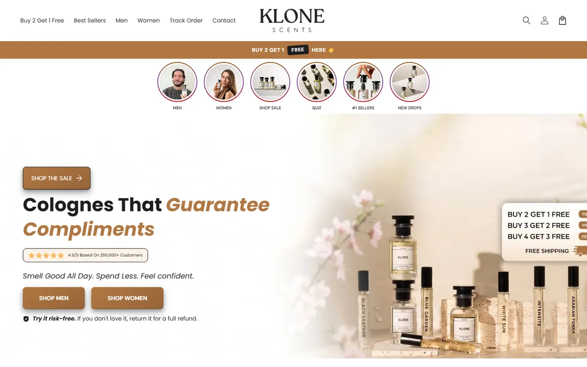

# Shopify build-your-own bundle picker

A product-page block that lets shoppers mix any scents into 1, 3 or 5-bottle offers, with gifts that unlock by tier.

**Live site:** https://klonescents.com  
**Portfolio:** https://izainpasha.github.io

## The problem
Klone Scents wanted shoppers to build their own fragrance bundle on the product page, while keeping discounts and gifts handled by their existing Kaching deal.

## What I built
A Liquid snippet with offer cards, a gift panel, a live subtotal and an accessible scent dialog, plus scoped JS and CSS. It preserves selections across offers and syncs with Kaching's cart items, so pricing stays native to Shopify.

## Result
Every tier verified against real Shopify cart totals, on mobile and by keyboard. (The base theme is a paid theme and is not included — only the files written for this feature.)

## Stack
Liquid · JavaScript · CSS · Kaching

---

Built by [Syed Zain Pasha](https://izainpasha.github.io) — full-stack and Shopify developer. Client data, credentials and environment files are not included.
